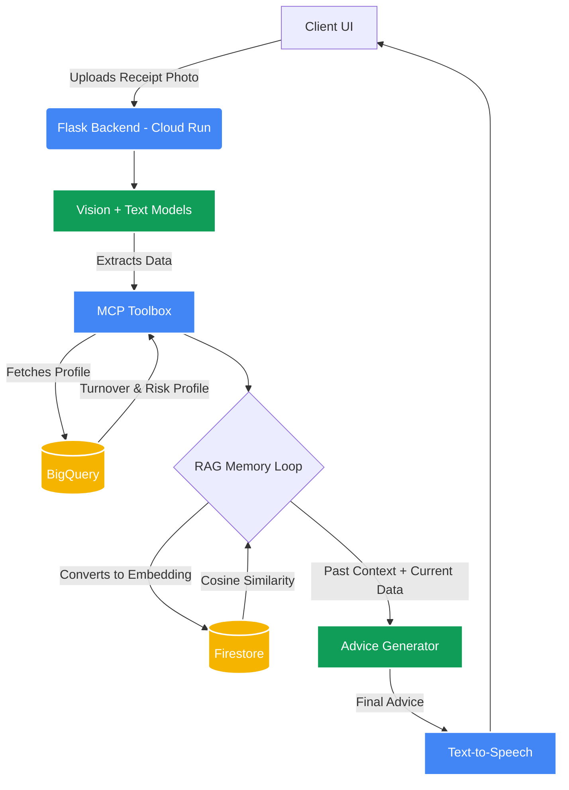

# Sahay: AI-Powered Financial Advisory Platform

Sahay is an AI-powered financial coach built for micro-entrepreneurs: such as tailors, grocery store owners, and street vendors—who run cash-based businesses without access to formal accountants. 

Users photograph their receipts, and Sahay extracts the data, cross-references spending against the business's typical cash flow, and delivers personalized advice aloud in the user's native language. Built during the Google Cloud Patchamomma Hackathon, this project solves a critical bottleneck in applied GenAI: **numerical hallucinations and unreliable data access**.

### Tech Stack
*   **Backend & API:** Python, Flask, Google Cloud Run
*   **AI Models:** Google Gemini & Groq (Configurable redundancy for vision and text extraction)
*   **Data & Memory:** Google BigQuery (Profiles), Firestore (RAG Embeddings), Cloud Storage (Image Archive)
*   **Architecture:** Model Context Protocol (MCP), Retrieval-Augmented Generation (RAG)
*   **Auth:** Firebase Authentication

---

## System Architecture

To ensure data security and prevent AI hallucinations, Sahay relies on a strictly decoupled architecture. 



---

## Key Engineering Decisions

### 1. Deterministic Arithmetic (Zero Math Hallucinations)
LLMs are prone to arithmetic errors. To eliminate this risk, all calculations—including summing totals and converting currencies—are executed entirely within the application code rather than the AI model. Furthermore, receipts are processed individually rather than batched to prevent the AI from dropping totals or mixing up currencies.

### 2. RAG Memory Loop (Context-Aware Advice)
Every financial analysis is saved alongside a compressed numerical "fingerprint" (embedding). Before generating new advice, the system uses cosine similarity to compare the current situation's fingerprint against past situations stored in Firestore. If a similar event occurred, that past context is retrieved and passed to the advice generator, allowing the model to reference past behavior directly.

### 3. Decoupled Data via MCP Toolbox
The core application never queries the BigQuery database directly. Instead, a separate Model Context Protocol (MCP) Toolbox service acts as an intermediary. The app requests data from the toolbox, and the toolbox securely queries BigQuery for the user's typical monthly turnover and risk category. This ensures new data sources can be added without altering the main application code.

### 4. Provider Redundancy
Because AI APIs can experience transient downtime, the vision-extraction and advice-generation layers are highly decoupled. The system is built to run on either Google's Gemini models or Groq's hosted open-weight models via simple configuration.

---

## Local Setup & Deployment

### Prerequisites
* Python 3.10+
* Docker
* Google Cloud SDK authenticated with your project

### Installation
1. Clone the repository:
   ```bash
   git clone https://github.com/aakansha1704/sahay-patchamomma.git
   cd sahay-patchamomma
   ```
2. Set up the virtual environment:
   ```bash
   python -m venv venv
   source venv/bin/activate
   pip install -r requirements.txt
   ```
3. Set your environment variables (create a `.env` file):
   ```text
   GCP_PROJECT_ID=your-project-id
   GEMINI_API_KEY=your-api-key
   GROQ_API_KEY=your-groq-key
   ```
4. Run locally:
   ```bash
   flask run
   ```

### CI/CD Pipeline
This repository leverages GitHub Actions for continuous integration. On every push to `main`, the CI workflow automatically provisions the environment, installs dependencies, and runs `flake8` to enforce syntax checks and prevent breaking changes from reaching production.